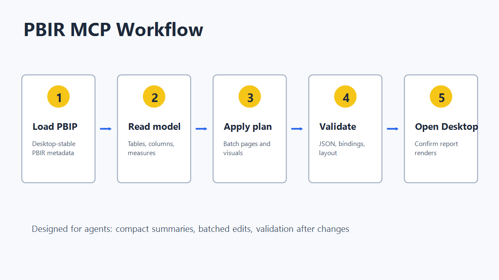
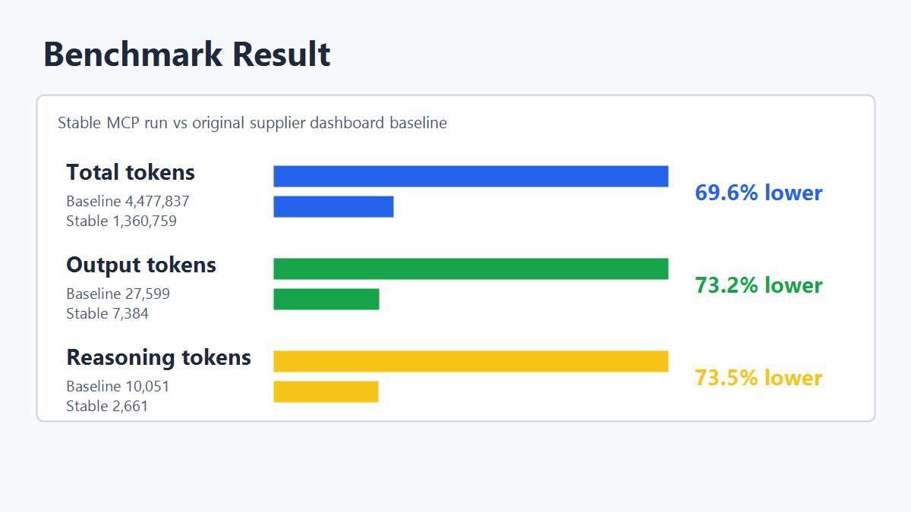

# Power BI PBIR MCP

Local MCP server for editing Power BI Project reports saved in PBIR format. It uses only the Python standard library and talks MCP over stdio.

## Install

From GitHub:

```powershell
pipx install git+https://github.com/bobzhou-source/powerbi-pbir-mcp.git
codex mcp add powerbi-pbir-report-mcp -- powerbi-pbir-mcp
```

From a local clone:

```powershell
git clone https://github.com/bobzhou-source/powerbi-pbir-mcp.git
cd powerbi-pbir-mcp
python -m pip install -e .
codex mcp add powerbi-pbir-report-mcp -- powerbi-pbir-mcp
```

Restart Codex, then run `/mcp`.

## What It Does

- Load `.pbip`, `.pbir`, `.Report`, or `definition` folders.
- Scaffold Desktop-stable PBIP/PBIR projects.
- Read semantic model tables, columns, measures, and source hints.
- Batch page, visual, theme, and layout changes with `pbir_apply_plan`.
- Validate JSON shape, bindings, layout bounds, and common Desktop blockers.

## Workflow



## Example Prompt

```text
Load C:\Reports\Supplier Dashboard.Report, summarize the pages and visuals,
then add an Executive Summary page with KPI cards and a supplier trend chart.
Use pbir_apply_plan and validate after edits.
```

## Benchmark



## Development

```powershell
python -m unittest discover -s tests
python -m pbir_mcp_server
```

Publishing notes are in [docs/PUBLISHING.md](docs/PUBLISHING.md).
